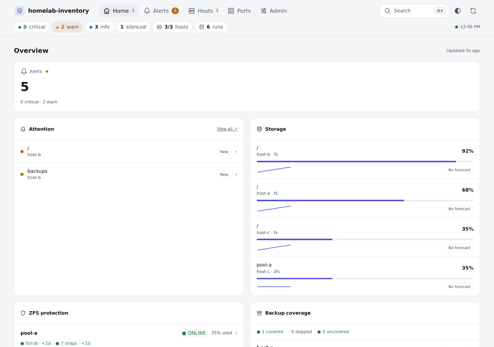
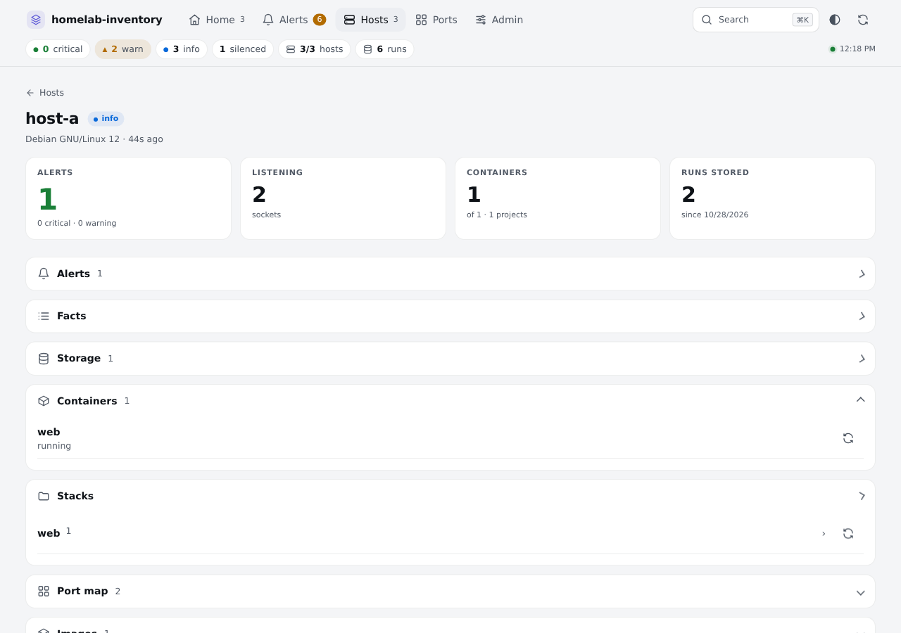
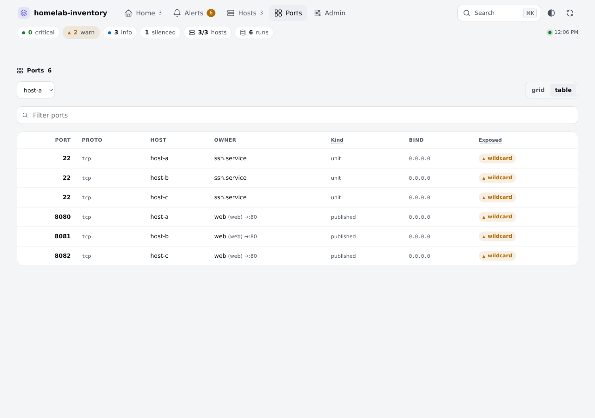

# homelab-inventory


A read-only inventory agent, API, and single-file dashboard for a Linux homelab. It collects hosts, Docker, Proxmox, ZFS, ports and storage, and presents alerts and history.

Features include packages, drift and trends, transition-only notifications via Apprise, a service launcher, optional signed agent self-update, optional restart actions, and an MCP bridge for assistants.

Optional read-only [Media plugin](docs/plugins.md#media) for Sonarr, Radarr, Tautulli and Overseerr.
Optional [Uploads](docs/plugins.md#uploads) to a folder, Paperless-ngx or Calibre-Web,
and read-only [Network](docs/plugins.md#network) traffic and probe views from Prometheus.
Configure and enable integrations in Admin → Plugins; each starts disabled.

## Quick start

On a Linux server:

```sh
curl -fsSL https://github.com/ficaa1/homelab-inventory/releases/latest/download/get.sh | sh
```

What it does:

- Uses Docker Compose when available; otherwise installs a static binary and a hardened systemd service.
- Downloads the release, verifies binary checksums, and keeps persistent data in `/var/lib/homelab-inventory`.
- Starts the API on port 8080 and prints the server's LAN URL and setup time remaining.
- Opens a wizard where you claim the instance, save your API token, and copy commands to add Linux hosts.

Run as root. If you run it as an ordinary user, it prints the exact command to
rerun through sudo. Open the printed URL **within 10 minutes**; the first visitor
becomes the administrator, so restrict access until setup is complete. Use
Admin → Add a host for later additions. See [installation](docs/install.md) for
flags, upgrades, removal and the manual Compose option.

Use HTTPS for untrusted networks. HTTP installer commands explicitly opt in to
plaintext credential transport. Signed updates and restart actions remain opt-in.

See [installation](docs/install.md), [configuration](docs/configuration.md), [self-update](docs/self-update.md), and [restart actions](docs/restarts.md).

| Program | Purpose |
| --- | --- |
| discover | Collect a host inventory |
| agentupdate | Post inventories; optionally supervise signed discover updates |
| agentsign | Sign agent releases |
| api | Ingest inventories and serve the dashboard and API |
| mcpbridge | Expose inventory reads over MCP |
| portmap | Summarize listening ports |
| alerts | Evaluate inventory alerts |

Discover uses allowlisted read-only commands and redacts sensitive data at collection. A null section means unavailable or not collected; an empty section means collected with no results. Alert notifications fire on transitions.

Linux agents are supported. A FreeBSD build exists with thinner collection. Proxmox, TrueNAS and ZFS are detected when present.

Status: v0.1, early. Licensed under [AGPL-3.0](LICENSE).






