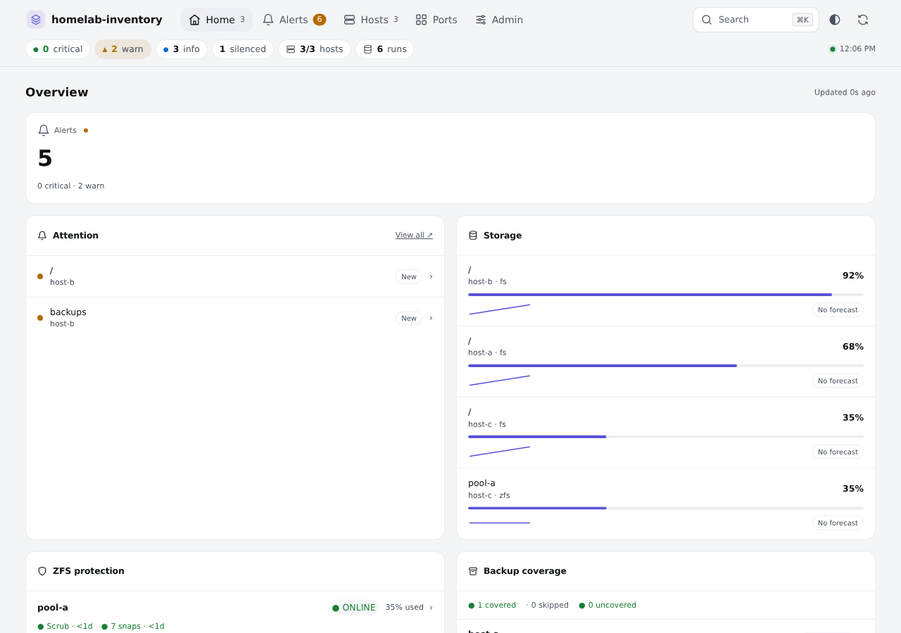

# homelab-inventory


Project page, with a live demo on an example fleet: [www.filipbiljic.com/homelab-inventory](https://www.filipbiljic.com/homelab-inventory/)

A dashboard for your homelab. An agent on each Linux host reads what is running
(containers, disks, ZFS, Proxmox, ports, packages) and reports it every
15 minutes. The dashboard shows it all in one place, flags problems, and links
to discovered web services.

Collecting inventory is read-only. Agent updates and dashboard actions are optional.

## Install

On a Linux server, as root:

```sh
curl -fsSL https://github.com/ficaa1/homelab-inventory/releases/latest/download/get.sh | sh
```

Then:

1. Open the address it prints and click **Claim this instance** within **10 minutes
   of startup**. The first person to claim it becomes the admin; keep it on your
   own network until then.
2. Save the API token it shows you. It is shown once.
3. Copy the **Add a host** command and run it on each Linux host.

It uses Docker Compose if available, otherwise a single binary with a systemd service.
With signing configured, [host setup](docs/install.md#add-hosts) can install or
convert agents to signed updates with one paste.
More options, upgrades and removal: [Install](docs/install.md).

## What you get

- **Overview** of every host, with what needs attention.
- **Alerts** for full disks, failed units, unhealthy containers, ZFS and backup
  problems. Alert notifications through [Apprise](https://github.com/caronc/apprise)
  only fire when something changes; summaries run separately. [All alerts](docs/alerts.md)
- **Forecasts** of when storage will fill up, once there is enough history.
- **Launcher** tiles for discovered web services, with editable names and addresses.
- **History**: what changed on a host, and package versions.
- **Plugins** for media, household Taste recommendations, Archive and Tdarr
  controls, uploads, network health and speed tests, Cloudflare and security
  canaries, plus Dusk TV pairing. Enable only the integrations you use.
  [Plugins](docs/plugins.md). Archive and Tdarr use the included
  [media-policy service](deploy/mediapolicy/README.md) for library policy and state.
- **Encrypted backups** in Admin, with previewed restore and private-dashboard
  migration. [Backup and migration](docs/backups.md)
- Optional: sign-in with a [passkey](docs/configuration.md#passkeys), or
  [with](docs/configuration.md#browser-sign-in-oidc) Google,
  Authentik, Authelia or Keycloak, [signed agent updates](docs/self-update.md),
  [container restarts](docs/restarts.md), [VPN recovery](docs/vpn.md), and an [MCP server](docs/api.md#mcp-bridge) for AI assistants.



## Good to know

- Linux hosts (amd64, arm64). Proxmox and ZFS are picked up when present.
  [TrueNAS SCALE](docs/install.md#truenas-scale-and-lxc) installs keep the agent on a pool dataset.
- Use HTTPS through your own reverse proxy. Plain HTTP enrollment requires an
  explicit opt-in; use it only on a trusted network.
- Docs: [install](docs/install.md), [configuration](docs/configuration.md),
  [plugins](docs/plugins.md), [alerts](docs/alerts.md), [VPN](docs/vpn.md), [API](docs/api.md),
  [security](SECURITY.md), [contributing](CONTRIBUTING.md).
- Status: early; latest release v0.2.1. Licensed under [AGPL-3.0](LICENSE).
